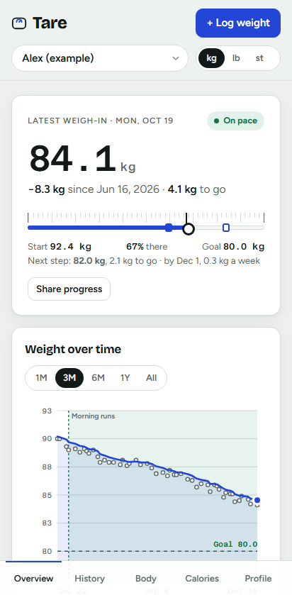
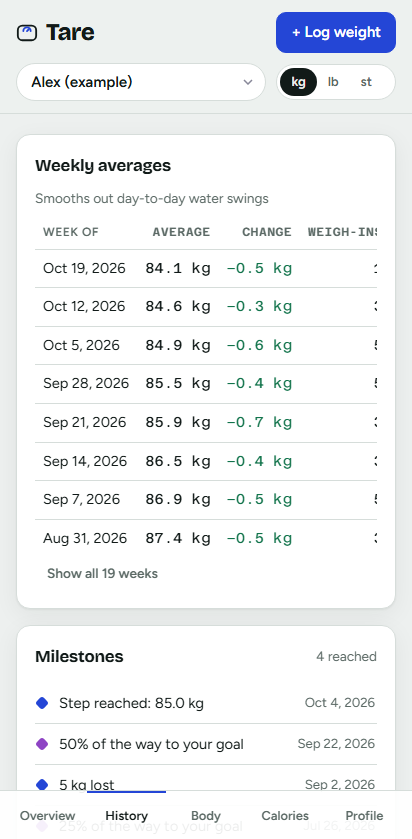

# Tare

A modern weight tracker that runs in the browser and installs on your phone like an app. Your data stays on your device: no account, no server, no tracking.

**[Open Tare](https://rihami.github.io/tare-weight-tracker/)**, then add it to your home screen. It works offline, in English and Czech.

<p>
  
  &nbsp;
  
</p>

Inspired by the iOS app *Monitor Your Weight*, rebuilt with a cleaner, modern design.

## Features

**See where you are**
- **Overview:** your weight as a big scale-style reading, a ruler from start to goal with your steps on the way, an On pace / Behind pace badge, and a trend chart (1 month to all time).
- **Statistics:** total change, what's left, the average change per day and week, a likely goal date (as a range) and the weekly pace you need.
- **History:** every weigh-in by month, each with a dot for on pace, slower, or away from the goal.
- **Weekly averages, streaks and milestones** (every 5 kg / 10 lb / 1 st, a quarter of the way, reaching the goal, a better BMI category). Logging a weight that reaches one says so.
- **Patterns:** plateaus, and the days of the week you tend to weigh more, each explained.
- **Month recap:** in the first week of each month, a look back at the last one: trend change, average, days logged, best week, milestones and events.

**Plan ahead**
- **Goal and steps:** a goal weight and date, with smaller steps on the way.
- **Re-plan when behind:** once you've fallen behind pace, Overview shows what keeping the date now takes (and whether that's healthy), and offers a realistic new date to move to in one tap.
- **Calorie calculator:** resting and maintenance calories, a daily target for your pace (Mifflin–St Jeor, or Katch–McArdle when you know your body fat), suggested protein, fat and carbs, and a table of paces with the date each would reach your goal. It never suggests less than 1,200 kcal (women) or 1,500 kcal (men), and warns about losing more than 1 % of body weight a week.
- **Health estimates:** BMI with its scale, a healthy weight range, ideal weight (Devine) and body fat from BMI or a tape measure (US Navy method).

**Log more than weight**
- **Body measurements:** waist, hips, chest, neck, upper arm and thigh, with trend lines and waist-to-height ratio.
- **Smart scale readings:** body fat, muscle and water, with how much of what you've lost was fat.
- **Events:** medication, a holiday, an illness, exercise or a diet change, shown as bands on the chart, with the trend before and since.
- **Cycle-aware weigh-ins:** with cycle tracking on, the days around a period (water retention) are marked and left out of the pace check and patterns.

**Logging made easy**
- **Quick log:** the log form opens by itself if you haven't weighed in today (once a day; can be turned off). On an installed app, long-press the icon and choose **Log weight**.
- **Typo check:** a weight far from your trend (94.1 instead of 84.1) is questioned once before it's saved. A normal day-to-day swing never is.
- **Reminders:** a daily reminder in the app if you haven't weighed in by your chosen time, a calendar file (.ics) with a daily alert, and an app icon badge.
- **[Logging from a link](#logging-a-weight-from-a-link)** for Siri Shortcuts, NFC tags and automation apps.

**Your data, kept safe**
- **On your device only**, with a backup reminder, full backups (.json), CSV export, and **automatic backups** to a folder (for example one synced by OneDrive or Google Drive).
- **PIN lock with encryption:** an optional 4–6 digit PIN, with auto-lock. Saved data is then encrypted (AES-256-GCM, key from the PIN with PBKDF2); downloaded backups are not, so keep them somewhere private. Face ID or a fingerprint can unlock it where the device supports it.
- **Import from other apps:** a CSV from almost any weight app (it finds the columns, date order and unit itself) or an Apple Health export, with a preview before anything is saved.
- **[Two devices](#using-tare-on-two-devices):** merge a backup from another device into this one.
- **Undo** for deletes and merges, and several windows stay in sync.

**Everything else**
- **Multiple profiles**, each with its own unit: kg, lb, or stones and pounds, with cm or inches.
- **English and Czech**, with numbers and dates to match (84.1 kg / 84,1 kg).
- **Light and dark mode**, following your device or chosen in the app.
- **Share your progress** as a picture, without weights unless you add them.
- **Printing:** any screen prints, or saves as a PDF, in light colours without the buttons (History for a doctor, say).
- **Installable and offline:** a Progressive Web App that works without internet.

## Using Tare on two devices

There's no account or server, so each device keeps its own data. To bring them together, download a backup on one (or let automatic backups save it to a OneDrive, Google Drive or Dropbox folder), then on the other choose **Restore from backup…** and **Merge into what's here**:

- **New things are added:** profiles, weigh-ins and events that aren't on this device yet.
- **The newer copy wins** where both have the same thing (a weigh-in on the same date, the same event, a profile's details).
- **Nothing is deleted.** Something removed on this device but still in the backup comes back, so delete it again after merging.
- **This device keeps** its settings, PIN and language.
- **Undo** takes a merge back for a few seconds afterwards.

Live sync between devices is discussed in [issue #19](https://github.com/RihaMi/tare-weight-tracker/issues/19).

## Logging a weight from a link

Opening Tare with `?log=` fills in the entry form; one tap on **Save** logs it. Nothing is saved without that tap, and the link is removed from the address bar afterwards.

| Part | Example | Default |
|---|---|---|
| `log` | `84.2` (a decimal comma works too) | required |
| `unit` | `kg`, `lb` or `st` | the unit chosen in the app |
| `date` | `2026-10-20` (not in the future) | today |
| `note` | `after+a+run` | none |

For example: `https://rihami.github.io/tare-weight-tracker/?log=84.2`

**Android:** an automation app (for example Tasker), a home-screen shortcut or an NFC tag on the scale can open the link. The installed app and Chrome share their data, so the weigh-in lands in your usual Tare.

**iPhone (Shortcuts and Siri):** make a shortcut with **Ask for Input** (Number, "Weight?"), then **URL** `https://rihami.github.io/tare-weight-tracker/?log=` followed by the answer, then **Open URLs**, and name it "Log my weight". Siri then runs it by name. One catch: iOS keeps a Home Screen web app's data separate from Safari's, and Shortcuts opens links in Safari. So this works if you use Tare in Safari, but not with Tare added to the Home Screen.

## Privacy

Tare makes no requests to other servers: no analytics, no ads, and the fonts are part of the app. Entries are stored only in your browser on your device, and nothing is sent to the site that hosts it. Clearing browser data deletes them, so use **Profile & goal → Download backup** now and then, or turn on automatic backups.

The BMI, body fat and calorie figures are general estimates, not medical advice.

## Development

You need [Node.js](https://nodejs.org/) 22 or newer.

```bash
npm install        # once
npm run dev        # local dev server at http://localhost:5173
npm test           # unit tests
npm run build      # production build into dist/
npm run e2e        # browser tests on the production build (build first)
npm run preview    # serve the production build at http://localhost:4173
```

To install it as an app locally, run `npm run build` and `npm run preview`, open http://localhost:4173 in Chrome or Edge, and choose **Install app**. Offline mode only works from the production build, not from `npm run dev`.

### Project structure

```
src/
  i18n/        translations: en.ts is the reference, cs.ts must cover every key (checked by TypeScript and tests)
  lib/         calculations: units, dates, BMI/body fat, calories, stats, insights, forecasts, PIN hashing (all unit-tested)
  data/        saved-data format and upgrades (schema.ts), storage, backups, merging, example data
  ui/          screens (views/), chart, entry dialog, small DOM helpers
  app.ts       app state shared by the screens
  main.ts      start-up, navigation, install and update prompts
public/        icons (npm run icons) and the install dialog's screenshots (npm run build, then npm run screenshots)
.github/       CI, browser tests, screenshot updates and the GitHub Pages deploy
```

### Tests and checks

`npm run e2e` runs Playwright tests in Chromium at desktop and phone size, and in WebKit (Safari's engine) at iPhone size. They cover the main flows, including logging a weight, units, the PIN lock, import, Czech and offline use. A few Chrome-only features (saving backups to a folder, the virtual authenticator for Face ID unlock) are tested in Chromium only. First run `npx playwright install chromium webkit` once, and `npm run build` before each run.

The same command runs the layout check, `scripts/visual-audit.js`, on every screen. It runs at 320, 414, 768 and 1440 px wide, in light and dark mode, in English and Czech. It looks for sideways scrolling, elements off the screen, cut-off or covered text, text drawn across a bar or badge, and contrast below WCAG AA. You can also paste the script into the browser console and run `await tareAudit()`.

On every pull request, GitHub Actions runs the unit tests, the browser tests and Lighthouse. Lighthouse must score 100 for accessibility and at least 90 for best practices; its report is saved with the run. Dependabot opens weekly pull requests for package and GitHub Actions updates.

**Screenshot tests** (`e2e/screens.spec.ts`) compare each screen with a reference image, at desktop and phone size and in dark mode, with the clock fixed to one day so the example data looks the same every run. Fonts render differently on each operating system, so the references are made on Linux and compared only there; on Windows and macOS these tests are skipped.

- **If a change is meant to look different**, update the references: put `[update screenshots]` in a commit message, or run **Update screenshots** from the Actions tab on your branch. The workflow commits the new images to the branch. Its own commit doesn't start the other checks, so push again (or re-run them) afterwards.
- **When they fail**, the report saved with the run shows the expected image, the actual one, and the difference.

### Adding a language

1. Copy `src/i18n/cs.ts` to a new file (for example `de.ts`) and translate every value. Keep the `{placeholders}` and give plural entries the forms the language needs (`one`, `few`, `many`, `other`).
2. Register it in `DICTS` and `detectLang()` in `src/i18n/index.ts`, add it to `Lang` in `src/data/schema.ts`, and add its name to `LANG_NAMES` in `src/ui/views/settings.ts`.
3. Run `npm test`. The tests check that no key is missing and that placeholders match.

### Saved data

- All saved data goes through the `Store` interface in `src/data/storage.ts`. It uses IndexedDB, falling back to localStorage. A cloud store for accounts and sync could be added as another `Store`, without changing the screens.
- The saved format has a version number (`SCHEMA_VERSION` in `src/data/schema.ts`). When the format changes, `migrate()` upgrades older data and backup files. Data from the original single-file version of Tare is picked up automatically.
- Every weigh-in has an id and an `updatedAt` time, which merging backups (and a future sync) uses to decide which copy is newer.
- With a PIN, `createSaver` encrypts before saving (`src/lib/crypto.ts`) and `loadData` returns the encrypted envelope as `locked`; the lock screen decrypts it. Decrypting is the PIN check, so a wrong PIN can never produce data.

### Hosting

Tare is a static site: `npm run build` produces `dist/`, which any static host can serve. It needs HTTPS for the app install, offline mode and the icon shortcut to work.

**GitHub Pages (how Tare is published).** `.github/workflows/pages.yml` builds the app and publishes it to [rihami.github.io/tare-weight-tracker](https://rihami.github.io/tare-weight-tracker/) on every merge into `main`, after the type check and unit tests pass. It can also be run from the Actions tab (**Deploy to GitHub Pages → Run workflow**). The build uses relative paths, so it works from the `/tare-weight-tracker/` sub-path.

**Cloudflare Pages or Netlify** work too, also from a private repository:

1. Cloudflare: sign in at [dash.cloudflare.com](https://dash.cloudflare.com), open **Workers & Pages → Create → Pages → Connect to Git**, and allow access to this repository only. Netlify: **Add new site → Import an existing project**.
2. Build command `npm run build`, output directory `dist`, and the environment variable `NODE_VERSION` = `24` (on Cloudflare, framework preset **None**).
3. Every merge into `main` updates the site, and every pull request gets its own preview address.

Both read `public/_headers`, which sets security headers (no framing, no referrer, no camera or location access) and caching: built files are kept for a year, while the page and service worker are always checked for a new version. GitHub Pages doesn't read it. On every host, the build adds a content security policy to the page itself (`vite.config.ts`): it may load only its own files, and inline scripts are blocked.

## Credits and licence

Fonts: [Bricolage Grotesque](https://github.com/ateliertriay/bricolage), [Figtree](https://github.com/erikdkennedy/figtree) and [Azeret Mono](https://github.com/displaay/azeret), all under the SIL Open Font License 1.1, installed from [Fontsource](https://fontsource.org). Only the Latin and Latin Extended subsets are included (`src/fonts.css`).

Tare is released under the [MIT licence](LICENSE).
